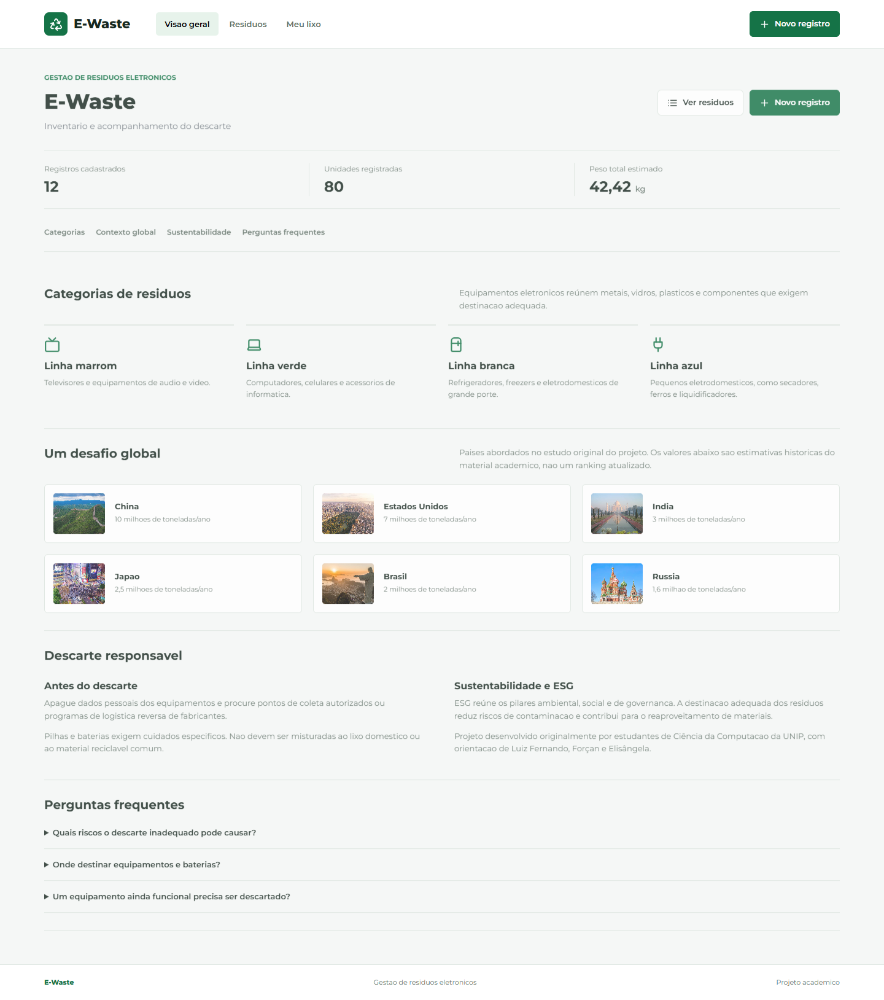
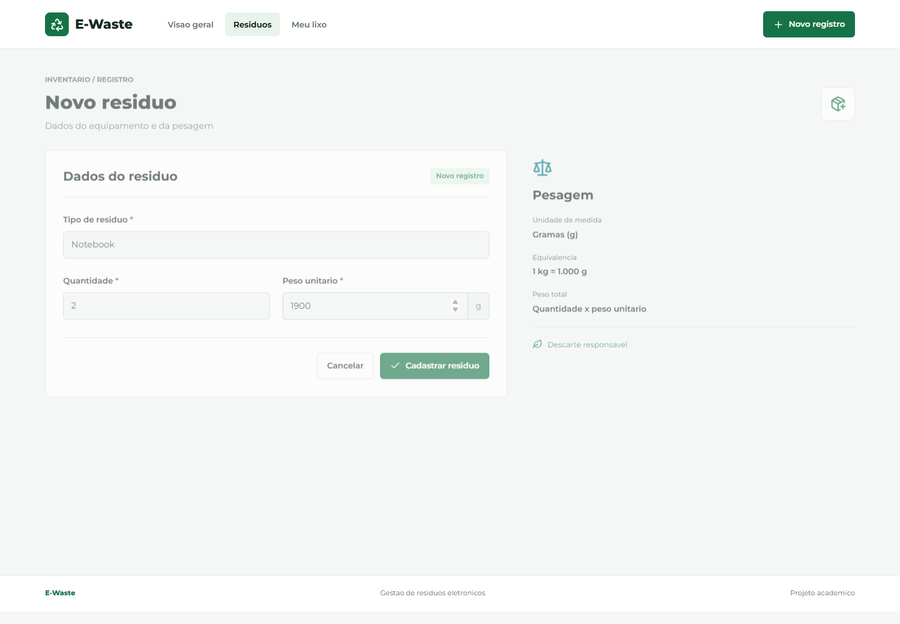
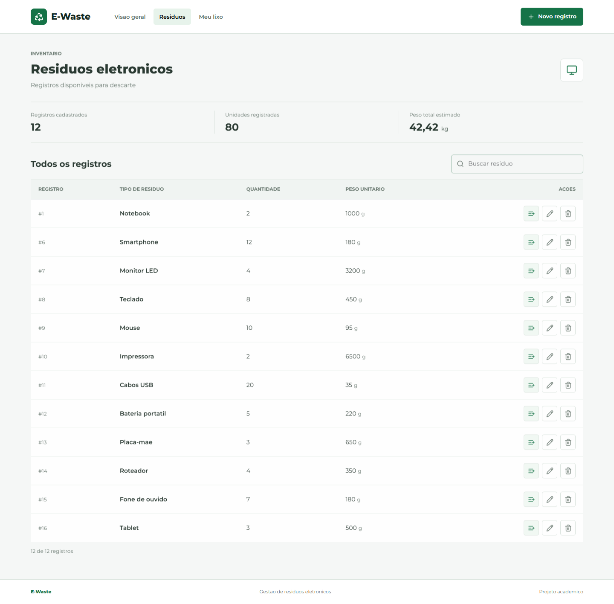
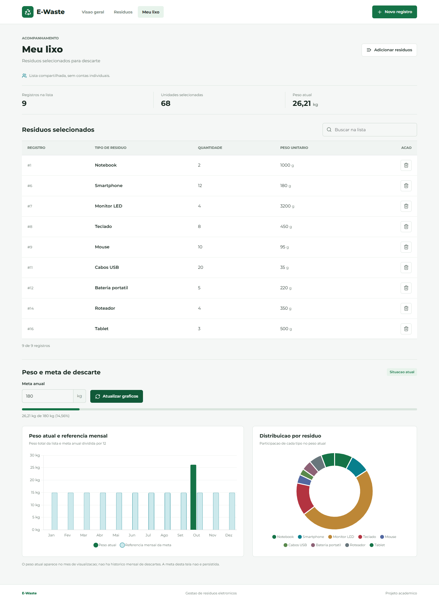
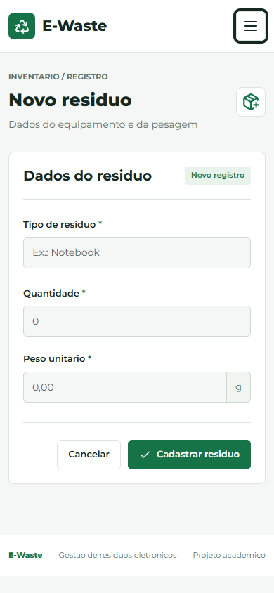

# E-Waste: Gestao de Lixo Eletronico

Projeto academico de uma aplicacao web para cadastrar residuos eletronicos,
organizar uma lista de itens e visualizar estimativas de peso em graficos.
O objetivo e apoiar o acompanhamento do lixo eletronico e a conscientizacao
sobre seu descarte.

## Funcionalidades

- Cadastro de tipo de lixo, quantidade e peso em gramas.
- Listagem, edicao e exclusao dos registros cadastrados.
- Busca por tipo de residuo e resumo de registros, unidades e peso estimado.
- Validacao no navegador e no servidor, mensagens de resultado e confirmacao de exclusao.
- Adicao de registros a lista "Meu Lixo" e remocao de itens dessa lista.
- Graficos de barras e rosca com base nos itens da lista e em uma meta anual informada em kg.
- Pagina inicial com conteudo sobre lixo eletronico.
- Carga opcional de dados ficticios para demonstracao, sem apagar registros existentes.

## Capturas de Tela

Capturas reais obtidas com Google Chrome, usando dados ficticios em um banco
isolado de demonstracao, sem alterar registros durante a captura.

### Visao Geral



### Cadastro de Residuos



### Listagem de Registros



### Meu Lixo e Graficos



### Cadastro no Celular



## Tecnologias

| Tecnologia | Uso |
| --- | --- |
| Java 17 (JDK) | Linguagem e compilacao |
| Spring Boot 2.7.5 | Aplicacao web e configuracao |
| Spring Web / Spring MVC | Rotas e controladores |
| Spring Data JPA / Hibernate | Persistencia dos registros |
| MySQL | Banco de dados |
| Thymeleaf | Templates HTML renderizados no servidor |
| Bootstrap 5.3.3 | Layout, navegacao, tooltips e modal de exclusao |
| Lucide 0.468.0 | Icones acessiveis |
| Montserrat | Tipografia servida localmente |
| Spring Validation | Validacao de campos no servidor |
| JavaScript / Chart.js 4.4.7 | Busca, totais e graficos no navegador |
| Maven Wrapper | Dependencias, compilacao e testes |

## Como Executar

### Pre-requisitos

- JDK 17 instalado, com `JAVA_HOME` apontando para o JDK e seu `bin` no `PATH`.
- Servidor MySQL em execucao e usuario com acesso ao banco da aplicacao.
- Acesso a internet para baixar dependencias Maven na primeira execucao.

As bibliotecas do frontend e a fonte sao servidas localmente. As versoes e
licencas estao documentadas em
[Recursos Locais](Aps%20-Lixo%20Eletrônico%20CRUD/bookStore/src/main/resources/static/vendor/README.md).

Confirme o ambiente com `java -version` e `javac -version`. Um JRE isolado nao
e suficiente. Nao e necessario instalar o Maven: o wrapper esta no projeto.

### Banco de Dados

No cliente MySQL, conectado com uma conta autorizada, crie o banco:

```sql
CREATE DATABASE IF NOT EXISTS lixoEletronico CHARACTER SET utf8mb4;
```

Use preferencialmente um usuario dedicado, com permissoes apenas nesse banco.
O Hibernate cria ou atualiza as tabelas ao iniciar, pois a configuracao atual
utiliza `spring.jpa.hibernate.ddl-auto=update`.

### Configuracao e Inicializacao no Windows

Na raiz deste repositorio, abra o PowerShell e execute:

```powershell
Set-Location "Aps -Lixo Eletrônico CRUD/bookStore"
$env:DB_URL = "jdbc:mysql://localhost:3306/lixoEletronico"
$env:DB_USERNAME = Read-Host "Usuario do banco"
$senha = Read-Host "Senha do banco" -AsSecureString
$env:DB_PASSWORD = [System.Net.NetworkCredential]::new("", $senha).Password
Remove-Variable senha
.\mvnw.cmd spring-boot:run
```

Abra [http://localhost:8080](http://localhost:8080). Para parar, pressione
`Ctrl+C`. Ao terminar, remova a senha do ambiente do terminal:

```powershell
Remove-Item Env:DB_PASSWORD -ErrorAction SilentlyContinue
```

`DB_USERNAME` e `DB_PASSWORD` sao obrigatorias. `DB_URL` e opcional e assume
`jdbc:mysql://localhost:3306/lixoEletronico` quando nao informada.
O Spring Boot nao carrega arquivos `.env` automaticamente; configure as
variaveis no terminal ou na sua ferramenta de execucao.

### Popular o Banco de Demonstracao

Configure uma conexao com um banco local de desenvolvimento, usando as mesmas
variaveis `DB_URL`, `DB_USERNAME` e `DB_PASSWORD` da secao anterior. Nunca ative
esta carga em um banco de producao ou com dados reais.

Na pasta do projeto Maven, ative explicitamente as duas condicoes:

```powershell
$env:SPRING_PROFILES_ACTIVE = "demo"
$env:DEMO_SEED = "true"
.\mvnw.cmd spring-boot:run
```

A carga executa em uma transacao na inicializacao. Em um banco vazio, cria
12 registros e seleciona 9 deles para a lista "Meu Lixo". Os exemplos incluem
notebooks, smartphones, monitores, teclados, mouses, impressoras, cabos,
baterias, placas-mae, roteadores, fones e tablets.

Se houver um cadastro de mesmo nome, sem distinguir maiusculas de minusculas,
ele sera reaproveitado sem alterar quantidade ou peso. Se houver mais de um,
sera utilizado o registro com menor ID. Itens ja presentes na lista nao sao
sobrescritos. Reexecutar a carga sem alterar os exemplos nao cria duplicacoes.
Exemplos excluidos podem ser recriados na proxima inicializacao com a carga ativa.

Para voltar a execucao normal, interrompa a aplicacao e remova essas variaveis:

```powershell
Remove-Item Env:SPRING_PROFILES_ACTIVE, Env:DEMO_SEED -ErrorAction SilentlyContinue
.\mvnw.cmd spring-boot:run
```

Sem o perfil `demo` e sem a ativacao `DEMO_SEED=true`, nenhuma carga e executada.
Os registros de demonstracao ja criados permanecem no banco; desativar a carga
nao apaga dados. Os exemplos nao simulam historico mensal de descarte.

### Testes

Na pasta do projeto, com o banco disponivel e as mesmas variaveis configuradas:

```powershell
.\mvnw.cmd test
```

O teste existente carrega o contexto do Spring Boot e depende da configuracao
do banco. Ele nao constitui cobertura completa das funcionalidades.

### Validacao Realizada

Em 2026-10-11, a compilacao com JDK 17 passou e a aplicacao foi executada
com MySQL 8.4 em um banco descartavel. Foram verificados pelo navegador:
cadastro, edicao sem perda dos demais campos, cancelamento, adicao e remocao
da lista, exclusao com confirmacao, busca, validacao de campos e graficos de peso.
As paginas inicial, de listagem, cadastro e lista foram verificadas em uma tela
de 390 x 844 pixels, sem rolagem horizontal da pagina e com menu funcional.
Os graficos foram recalculados repetidamente sem duplicar instancias do Chart.js.

A carga foi executada duas vezes no mesmo banco: resultou em 12 registros e
9 itens na lista, preservando o cadastro original. A segunda execucao nao
inseriu registros nem itens adicionais. Quantidades e pesos nas capturas podem
diferir dos exemplos padrao porque registros existentes sao preservados.

O empacotamento e a suite Java/Maven nao foram concluidos neste ambiente:
o download de `net.bytebuddy:byte-buddy-agent:1.12.18` retornou HTTP 403.
Os testes funcionais automatizados com Playwright e Google Chrome passaram,
mas nao substituem a execucao da suite Java/Maven.

Neste ambiente corporativo, a importacao Maven do editor tambem apresentou
erro de certificado `PKIX`. A compilacao pelo Maven Wrapper passou usando
o JDK 17 portatil e o repositorio de certificados confiaveis do Windows.
Nao desative a validacao TLS para contornar falhas de importacao no editor.

## Organizacao

O projeto Maven esta em [Aps -Lixo Eletronico CRUD/bookStore](Aps%20-Lixo%20Eletrônico%20CRUD/bookStore).

| Pasta no projeto Maven | Conteudo |
| --- | --- |
| `src/main/java/com/bookStore/controller` | Rotas e controle das telas |
| `src/main/java/com/bookStore/entity` | Entidades persistidas |
| `src/main/java/com/bookStore/repository` | Acesso ao banco |
| `src/main/java/com/bookStore/service` | Servicos da aplicacao |
| `src/main/java/com/bookStore/config` | Carga opcional de demonstracao |
| `src/main/resources/templates` | Paginas Thymeleaf |
| `src/main/resources/templates/fragments` | Navegacao e formulario compartilhados |
| `src/main/resources/static/css` | Estilos comuns |
| `src/main/resources/static/js` | Busca, totais, modais e graficos |
| `src/main/resources/static/vendor` | Bibliotecas locais e licencas |
| `src/main/resources/static/fonts` | Fonte local e licenca |
| `src/main/resources/static/photos` | Imagens utilizadas pelas telas |
| `src/test/java` | Testes |

Os identificadores internos `bookStore`, `Book` e as rotas com `book` sao
nomes legados e foram preservados para evitar alteracoes de comportamento.

## Limitacoes e Seguranca

- A aplicacao nao possui autenticacao nem isolamento da lista por usuario. "Meu Lixo" representa uma lista compartilhada, nao uma conta pessoal.
- O grafico de barras atribui o peso total ao mes atual; nao existe historico mensal de descartes. A meta informada e usada no navegador e nao e persistida.
- Novos registros exigem quantidade inteira positiva, peso positivo com ate duas casas decimais e tipo de residuo com ate 100 caracteres. Dados antigos invalidos nao sao corrigidos automaticamente e sao excluidos dos graficos, quando detectados.
- O arquivo SQL em `db.migration` nao e executado automaticamente: nao ha Flyway configurado no projeto.
- A versao do Spring Boot e antiga. Revise dependencias e seguranca antes de qualquer implantacao publica; este projeto nao deve ser tratado como pronto para producao.
- Nunca publique senhas, tokens, arquivos de ambiente ou dados pessoais. Credenciais anteriormente publicadas devem ser trocadas, mesmo apos sua remocao dos arquivos atuais, pois podem permanecer no historico Git.

O historico alcancavel deste repositorio foi sanitizado nesta revisao, com
backup original preservado apenas localmente. Isso nao elimina copias externas,
caches ou forks. Ao utilizar uma copia anterior, alinhe-a ao historico novo
para nao reintroduzir a configuracao antiga. A troca das senhas e obrigatoria.

## Autoria e Licenca

Kayky Crespo dos Santos, conforme a autoria registrada na [licenca MIT](LICENSE).
Preserve os creditos e a licenca ao reutilizar este projeto.
